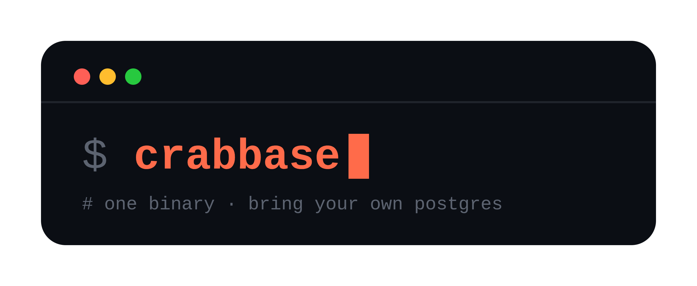

# Crabbase

<div align="center">
  
</div>

**The simplicity of PocketBase. The flexibility of PostgreSQL.**

Crabbase is a self-hosted backend-as-a-service that turns a PostgreSQL database into a ready-to-use backend. Define your collections, get REST APIs and authentication out of the box, and manage everything through a built-in admin dashboard — all from a single binary.

Unlike backends built around an embedded database, Crabbase connects to a PostgreSQL server you choose and control. Your data stays in standard PostgreSQL tables, accessible through familiar tools and SQL, while your backend remains lightweight and easy to deploy.

**Why Crabbase?**

- **One binary, ready-to-use backend.** Run the API server and admin dashboard without assembling a stack of separate services.
- **PostgreSQL at the core.** Use your own local, self-hosted, or managed PostgreSQL instance. Your data remains in a database you control.
- **APIs without boilerplate.** Create collections dynamically and get CRUD endpoints, authentication, filtering, and access rules without writing custom routes.
- **Deploy on your terms.** Run Crabbase on your own infrastructure or alongside a managed PostgreSQL service.
- **Your data stays yours.** Work with real PostgreSQL tables and rows using SQL and your existing database tools.

Crabbase is for developers who want the convenience of a backend-as-a-service without giving up the flexibility and portability of PostgreSQL.

*Self-hosted. PostgreSQL-powered.*

**Status:** Pre-1.0 and under active development. Some features are still in progress; see the roadmap and limitations below.


## Architecture

```
crabbase/            Main binary (CLI: serve | admin)
crates/
  core/              Models, filter-rule parser/compiler, logging
  db/                Repositories: collections, records, auth, settings, files
  api/               Axum REST router (all HTTP endpoints)
  auth/              JWT service, refresh-token rotation, OTP/password reset
  files/             File storage (local disk / S3-compatible)
  realtime/          (placeholder) WebSockets / sync
  hooks/             (placeholder) Background hooks
  admin-ui/          Yew admin dashboard, embedded into the binary
migrations/          SQL migrations (embedded in the binary, run at boot)
```

Everything is compiled into one self-contained binary — the only required external service is PostgreSQL (S3-compatible storage is optional). The `admin` command serves both the dashboard and the full API on one port.

```
┌───────────────────────┐        ┌──────────────────────────┐
│  crabbase (1 binary)  │        │   Your PostgreSQL         │
│  ─ API + admin UI ─   │ ─────► │   (yours to operate:     │
│  embedded migrations, │  TCP   │    backups, replicas,    │
│  dashboard, templates │        │    pooling, HA, ...)      │
└───────────────────────┘        └──────────────────────────┘
```

Because records, sessions, and settings live in Postgres, scaling Crabbase means scaling Postgres — and you can run several Crabbase instances against the same database with no extra coordination. Uploaded files are the exception: use S3-compatible storage (or a shared volume) when running more than one replica with local-disk storage.

## Quickstart

### Prerequisites

- Rust (stable) — <https://rustup.rs> (only for building; a release binary needs nothing)
- **Any PostgreSQL 14+ server** — local, Docker, or a managed instance. This is the whole infrastructure requirement.
- `psql` CLI (optional — only the helper scripts use it)

The dashboard's compiled JS/WASM assets are build artifacts (only the HTML shell is committed), so build them once with [Trunk](https://trunkrs.dev) and the `wasm32-unknown-unknown` target: `cd crates/admin-ui && trunk build` (or `make release`). After that, `cargo` is enough to run either command; the API-only `serve` command never needs the dashboard assets.

### 1. Configure with `crabbase.toml`

Crabbase is configured entirely through a **TOML file** (default: `crabbase.toml` in the project root). Copy the example and edit it:

```sh
cp example.crabbase.toml crabbase.toml
```

The file has three sections, plus optional `[[initial_users]]` entries:

```toml
[database]
host = "localhost"
port = 5432
user = "postgres"
password = "postgres"   # prefix with $ to load from an env var, e.g. $DB_PASSWORD
database = "crabbase"
schema = "crabbase"
max_connections = 10

[server]
host = "0.0.0.0"
port = 8989

[admin]
host = "0.0.0.0"
port = 9898

# Superusers to create if missing on first boot (array of tables)
[[initial_users]]
email = "admin@crabbase.local"
name = "admin"
password = "admin123"   # or $ADMIN_PASSWORD to pull from env
```

**Secret values** — the `password` fields (`[database]` and each `[[initial_users]]` entry) treat a value starting with `$` as an environment variable reference. For example:

```toml
password = "$DB_PASSWORD"   # reads the DB_PASSWORD env var at startup
```

This keeps credentials out of the config file while still letting you commit a sanitised version to version control.

**Custom config path** — pass `--config <path>` to either subcommand if you want to keep the file somewhere else:

```sh
cargo run -- serve --config /etc/crabbase/prod.toml
cargo run -- admin --config /etc/crabbase/prod.toml
```

### 2. Run

```sh
# Terminal 1 — admin dashboard (also serves its own API on :9898)
make admin

# Terminal 2 — standalone public API on :8989 (used by the curl examples below)
make serve
```

If this is a fresh checkout, build the dashboard assets once (see above) before using `make admin`. Both processes share the same Postgres database.

Or directly (the `--config` flag defaults to `crabbase.toml` in the current directory):

```sh
cargo run -- admin --config crabbase.toml
cargo run -- serve --config crabbase.toml
```

On startup Crabbase reads the TOML file, connects to Postgres, runs all pending migrations, creates any missing `initial_users` superusers, and prints the banner.

### 3. Open the dashboard

Visit `http://localhost:9898` and log in with the email/password you configured in `[[initial_users]]`. **Almost everything can be done here without touching curl or code:**

- **Create collections** — pick a name, type (`base`/`auth`), add fields of any type, toggle indexes
- **Manage records** — browse, create, edit, delete data in any collection; this includes **creating users** in auth collections
- **Edit schemas live** — add/remove/retype fields, set API rules per collection
- **Configure the app** — general settings, SMTP mail settings, file storage, email templates
- **View logs** — activity logs page (currently sample data; no logs API yet)

The dashboard is a client of the same REST API your apps use — everything backed by the API is also doable over HTTP.

> The admin command runs the dashboard *and* the full API on one port (9898), so it can be your only process — use `http://localhost:9898/api` for API calls in that setup. But since both keep application state in Postgres, you can also run `serve` separately — e.g. keep the dashboard on an internal port/host while public traffic hits `serve` on 8989.

### 4. Or use pure curl

```sh
# Login as superuser
TOKEN=$(curl -s -X POST http://localhost:8989/api/auth/_superusers/login \
  -H 'Content-Type: application/json' \
  -d '{"email":"admin@crabbase.local","password":"admin123"}' \
  | jq -r .tokens.accessToken)

# Create a collection -> a real table + instant REST endpoints
curl -X POST http://localhost:8989/api/collections \
  -H "Authorization: Bearer $TOKEN" -H 'Content-Type: application/json' \
  -d '{
    "name": "products",
    "columns": [
      { "name": "title",  "data_type": "PlainText", "index": true },
      { "name": "price",  "data_type": "Number" },
      { "name": "active", "data_type": "Bool" }
    ],
    "list_rule": "",
    "view_rule": "",
    "create_rule": ""
  }'

# Create a record — no deployment, no code
curl -X POST http://localhost:8989/api/collections/products/records \
  -H 'Content-Type: application/json' \
  -d '{"data":{"title":"Widget","price":999,"active":true}}'

# List records (with pagination & filtering)
curl 'http://localhost:8989/api/collections/products/records?page=1&per_page=20'
curl -G 'http://localhost:8989/api/collections/products/records' \
  --data-urlencode "filter=price < 1000 && active = true"

# List records with expanded relations (no N+1 queries)
curl 'http://localhost:8989/api/collections/books/records?expand=author'
```

---

## Local Development Environment (Docker Compose)

For local development, Crabbase runs directly on your machine as a native binary, while backing infrastructure (**PostgreSQL 16** and **Floci** AWS emulator) runs via Docker Compose.

### 1. Start the backing services

```sh
docker compose up -d
```

This spins up:
- **PostgreSQL 16**: available at `localhost:5432` (`database: crabbase`, `user: postgres`, `password: postgres`) with persistent volume storage.
- **Floci AWS Emulator**: available at `http://localhost:4566` (providing local S3, SQS, SES, SNS emulation).

> **Note:** If port `5432` is already in use by a local PostgreSQL instance, specify a custom port: `POSTGRES_PORT=5433 docker compose up -d` and update `port = 5433` in `crabbase.toml`.

### 2. Run Crabbase

Once the database and emulator are up, run Crabbase directly from your terminal:

```sh
# Run Admin Web Dashboard + REST API
make admin        # http://localhost:9898

# Or run the headless REST API
make serve        # http://localhost:8989
```

Or via cargo:

```sh
cargo run -- admin --config crabbase.toml
cargo run -- serve --config crabbase.toml
```

Crabbase connects to `localhost:5432`, applies pending SQL migrations automatically, creates any missing initial superusers, and starts serving.

### 3. Stop the backing services

```sh
docker compose down
```

---

## Documentation

| Doc | Contents |
|---|---|
| [Getting started](docs/getting-started.md) | Installation, configuration, running, Makefile targets |
| [Collections & records](docs/collections-and-records.md) | Field types, creating/updating schemas, CRUD endpoints, dynamic `?filter`, relation `?expand`, API rules |
| [Authentication](docs/authentication.md) | Auth collections, login/refresh/logout, password reset, superusers |
| [Files & uploads](docs/files-and-uploads.md) | File columns, multipart uploads, attaching files to records, protected downloads/file tokens, storage backends |
| [Settings & email](docs/settings-email.md) | App/mail/storage settings, SMTP setup, email templates |
| **Interactive API docs** | Debug builds → `GET /api/docs` (Swagger UI), spec at `/api/openapi.json` (excluded from release builds) |

## Using Crabbase as your backend

The intended workflow requires **no custom REST code** — and for most of it, no curl either. The admin dashboard is the primary tool:

1. **Model your data as collections** — in the dashboard's Create Collection drawer (or `POST /api/collections`). Relations are first-class.
2. **Create users and seed data** — open an auth collection in the dashboard and add user records directly; passwords are hashed for you, and remember to toggle **Verified** so the user can log in. Same for any other collection's initial data.
3. **Consume the generated endpoints** from your frontend/mobile app:
   - `GET/POST /api/collections/{name}/records`, `GET/PATCH/DELETE .../records/{id}` (with `?filter=...` and `?expand=...` support)
   - For auth collections: `POST /api/auth/{collection}/login`, `/auth-refresh`, `/logout`
4. **Protect data with API rules** — set `list_rule`, etc. in the collection's edit drawer, e.g. `owner = @request.auth.id` so users only see their own rows.
5. **Configure email** once in Settings → Mail, and password resets just work out of the box.

Every step has a REST equivalent documented in [docs/](docs/) if you prefer automation or IaC.

## Deploying & scaling

Because Crabbase delegates application state (records, sessions, settings) to PostgreSQL, deployment and scaling are straightforward:

- **Container Deployment**: Package the release binary in a container image (no Dockerfile ships yet) and run it on AWS ECS, Fly.io, Google Cloud Run, Render, or Kubernetes against any managed PostgreSQL instance (Supabase, Neon, AWS RDS, Cloud SQL).
- **Horizontal Scaling**: Run multiple Crabbase containers behind any reverse proxy or load balancer (Nginx, Traefik, Caddy, Cloudflare). Since collections, settings, and refresh-token sessions live in Postgres, multiple replicas share application state with zero coordination; point them at the same S3 bucket (or shared volume) for uploaded files.
- **Connection Pooling**: Place PgBouncer between Crabbase instances and PostgreSQL when scaling to handle thousands of concurrent client connections.
- **Admin & API Separation**: Deploy `crabbase admin` on an internal/VPN-protected port for administration, while exposing `crabbase serve` containers for public client traffic.

## Development

```sh
make build                  # debug build
make test                   # full suite: unit + DB + HTTP API (needs Postgres)
make test-unit              # fast unit tests (no database)
make test-db                # DB repository tests
make test-integration       # HTTP API integration tests
make test crate=db          # a single suite (e.g. db, records, auth)
make watch                  # bacon watch + auto-reload (serve)
make watch-fe               # trunk dev server for the admin UI
make release                # optimized release build (builds admin UI first)
```

Utility scripts for load testing:

```sh
scripts/create_test_collections.sh --count 20 --rows 100   # generate test collections + data
scripts/pg_seed.sh --table _logs --rows 500                # seed any table
```

## Roadmap & limitations

Implemented and working:

- Collections (create/update/delete/truncate, live schema migration, indexes)
- Records CRUD with pagination, client `?filter` dynamic query evaluation, batch relation expansion (`?expand`), and `list_rule` / `view_rule` / `create_rule` / `delete_rule` enforcement
- Auth collections, JWT login/refresh/logout, password reset with emailed OTP
- Superusers, settings APIs, email templates, admin dashboard (with real-time records filter search)
- File uploads/storage with per-column constraints, local disk or S3-compatible backends, cleanup on record update/delete, and protected downloads via file tokens
- Swagger UI / OpenAPI (debug builds only)

Not yet (placeholders exist in the codebase):

- **Realtime** — no websockets/SSE subscriptions.
- **Hooks** — no background triggers.
- **Dedicated registration & email-verification endpoints** — public signup works by setting `create_rule = ""` on an auth collection and POSTing a record; `allowPublicUserRegistration` exists but is not enforced, and there is no verification flow.
- **Logs API** — the dashboard's logs page shows sample data; the `_logs` table exists but is not read or written by the API.
- **Backups & cron settings** — the dashboard pages are UI placeholders with no backend.
- `update_rule` expressions are not applied to rows yet: a null rule blocks non-admins, while an empty string allows everyone. `list_rule`, `view_rule`, `create_rule`, and `delete_rule` are enforced.

Security notes while the project evolves:

- Rotate the seeded `_superusers` token secret (migration `00001` seeds a hardcoded value).
- CORS is fully permissive in the current API server — tighten before exposing publicly.
- Change the seeded superuser password immediately after first boot (in the dashboard or via the API — editing `[[initial_users]]` later does not update an existing account).
